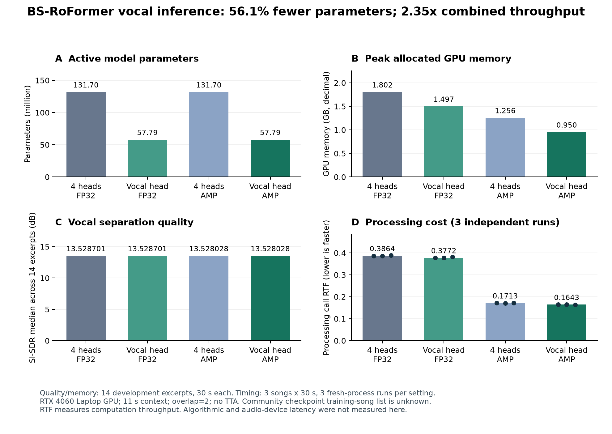

# VocalStream

**Reproducible vocal separation experiments: quality, computation, and bounded-future streaming.**

[中文说明](README.zh-CN.md) · [Measured results](docs/RESULTS.md) · [Reproduce the experiments](docs/REPRODUCING.md) · [Methodology](docs/METHODOLOGY.md)

[CV summary](docs/CV.md) · [Interview learning guide (中文)](docs/INTERVIEW_GUIDE.zh-CN.md) · [Release checks](docs/RELEASE_READINESS.md)

VocalStream investigates a practical question: **what happens to vocal separation quality and processing cost when a strong pretrained model is adapted to a narrower output task and a stricter output schedule?**

The project uses Open-Unmix as a baseline and a pinned community BS-RoFormer checkpoint as its main reference. It includes vocal-head selection, mixed-precision inference, controlled vocal-bleed experiments, explicit audio metrics, and a file-stream simulator that limits access to future input.

The current result is a measured engineering study. The simulated streaming implementation exceeds its 20/80 ms compute budgets; live low-latency deployment is a remaining research goal. For a quick review, read the two measured optimizations below, then inspect the [evidence and limitations](docs/RESULTS.md). The additional educational training utilities are outside the main measured project.

## Main results

Measured on an **NVIDIA RTX 4060 Laptop GPU**, Python 3.12, PyTorch 2.11.0+cu128, with one PyTorch CPU thread. Quality uses the same 14 MUSDB18-HQ development excerpts, 60–90 s in each song. Timing uses three fixed 30 s excerpts and three fresh-process repetitions per setting.

| Setting | Vocal SI-SDR median, dB | Active parameters | Peak allocated VRAM, GB | Median processing RTF |
| --- | ---: | ---: | ---: | ---: |
| Four heads, FP32 | 13.528701 | 131.70 M | 1.8019 | 0.386387 |
| Vocal head, FP32 | 13.528701 | 57.79 M | 1.4969 | 0.377215 |
| Four heads, AMP | 13.528028 | 131.70 M | 1.2556 | 0.171275 |
| Vocal head, AMP | 13.528028 | 57.79 M | 0.9503 | 0.164287 |

- Vocal-head selection retained sample-identical vocal outputs in **14/14 excerpts within each precision** and removed **56.12% of active parameters**. The original checkpoint file stays unchanged.
- Head selection alone reduced measured call time by **2.37% in FP32 / 4.08% in AMP**. Combining head selection with AMP yielded **2.35× throughput** relative to four-head FP32; most of this speed gain came from AMP.
- AMP introduces small numerical differences relative to FP32: the paired median SI-SDR change was approximately **−0.000176 dB**.
- Smaller parameter count did not produce a proportional speedup, motivating further profiling rather than estimating speed from model size.



RTF = processing seconds / audio seconds. It measures throughput, not algorithmic or audio-device latency. VRAM values use decimal GB and PyTorch's peak allocated-memory counter.

### Earlier streaming result

The rolling-window adapter uses a fixed two-second context and explicitly separates cached past, emitted samples, and lookahead. On three four-second development clips, its median per-emission compute time was approximately **208 ms**. All measured steady-state emissions exceeded the declared 20/80 ms compute periods. More lookahead improved quality on these clips, while repeated offline-window computation caused substantial backlog.

See [the full result tables and limitations](docs/RESULTS.md). This result describes the implemented recomputation schedule, not a lower bound for all possible BS-RoFormer streaming implementations.

### New experimental window policy

An opt-in `single` mode removes nested offline overlap-add and invokes the network once per stream context. The original `ola` mode remains the default. A completed **25-job matched GPU study** on three short development clips reduced block-compute medians from approximately **183 ms to 91 ms**. All four schedule-level paired SI-SDR medians improved, with small regressions in two song/schedule pairs. **All schedules still exceeded their 20/80 ms compute budgets.** Automated regression checks were added for the November release; see [release verification](docs/RELEASE_READINESS.md). See [measurements, scope and reproduction](docs/WINDOW_INFERENCE.md).

## Quick start

Use **Python 3.12**. Run commands from this repository root. The recorded GPU environment uses CUDA 12.8 PyTorch wheels and a compatible NVIDIA driver.

```shell
git clone https://github.com/junxilucian-rgb/vocalstream.git
cd vocalstream
conda create -n vocalstream python=3.12 pip -y
conda activate vocalstream

python -m pip install torch==2.11.0 torchaudio==2.11.0 --index-url https://download.pytorch.org/whl/cu128
python -m pip install -e .
python download_bs_roformer_assets.py
```

The downloader retrieves approximately 527 MB of external weights, checks pinned SHA-256 values, and records provenance. Obtain model assets under their publisher's conditions; the repository's MIT license applies to project code.

Separate one stereo **44.1 kHz WAV or FLAC** file:

```shell
python evaluate_project.py --input path/to/music.flac --system bsroformer --bs-heads vocals --precision amp --overlap 2 --device cuda --save-audio --out results/demo_01
```

The output folder must be new. It contains `report.json`, a metrics CSV, and `track_001/vocals_estimate.wav`. Without aligned reference vocals, this is a listening demonstration and no separation-quality score is reported.

For CPU use, install matching CPU PyTorch wheels first and use `--device cpu --precision fp32`. The published speed measurements apply to the recorded GPU setup.

## MUSDB18-HQ experiments

Request the dataset from the [official MUSDB page](https://sigsep.github.io/datasets/musdb.html) and follow its access and usage conditions. Point `MUSDB_ROOT` at your extraction folder, or pass `--root` explicitly.

```text
data/musdb18-hq/
├── train/
│   └── Song Name/
│       ├── mixture.wav
│       ├── vocals.wav
│       ├── drums.wav
│       ├── bass.wav
│       └── other.wav
└── test/
    └── ...
```

The published development studies read only the selected songs from `train`. The separate data-inventory utility inspects both dataset folders; it does not run separation or use test scores for selection.

```shell
python run_head_optimization.py --root path/to/musdb18-hq --out results/head_study_01
python build_head_optimization_report.py --run results/head_study_01

python run_streaming_study.py --root path/to/musdb18-hq --out results/stream_study_01
python build_streaming_study_report.py --run results/stream_study_01
```

These studies require the pinned weights, a CUDA device, and full HQ train inventory. Run GPU studies sequentially. The head study has 16 declared jobs; the short streaming study has 13. Completed jobs, exact commands, source/asset hashes, audio fingerprints, and timing scope are recorded in each local result directory.

[Detailed reproduction guide](docs/REPRODUCING.md) covers baseline/bleed experiments, report generation, long-run validation, and the freeze-before-test workflow.

## Repository map

```text
vocalstream/                 Audio loading, metrics, models, streaming, vendored source
evaluate_project.py         One-file or aligned-dataset evaluation
run_head_optimization.py     Four-head/vocal-only × FP32/AMP study
run_streaming_study.py       Explicit future-input and output-schedule study
run_refinement.py           Baseline, bleed, and vocal-preservation experiments
run_reference_project.py    Development/whole-song validation/freeze/test workflow
build_*_report.py           Post-processing and integrity-aware report generation
analysis_tools/             Plotting and exploratory analysis
reports/                    Sanitized measured evidence and provenance
assets/                     Public result figures
docs/                       Protocols, results, data, and reproducibility notes
tests/                      Existing engineering checks from development
```

The STFT–GRU and Mel-Band RoFormer modules are additional research utilities. The main measured model above is **BS-RoFormer**, not Mel-Band RoFormer. Development used Codex-assisted implementation and experiment orchestration; the contributions here are task-specific inference changes, evaluation design, and analysis, rather than a new separation architecture.

## Scope and reproducibility

- The checkpoint comes from ZFTurbo's community release, not the original paper's checkpoint. Its complete training-song list is undisclosed, so development scores do not establish independent generalization.
- Quality uses a whole-segment, joint-stereo **SI-SDR** implementation. These values are not interchangeable with paper BSSEval/SDR leaderboards.
- Whole-song validation, frozen full-test benchmarking, physical microphone recordings, acoustic-feedback loops, and audio-device end-to-end latency remain future work.
- Streaming queue times are virtual scheduling calculations based on measured compute. They are not observed hardware latency. Both window policies recompute the network and have no neural-state cache; `single` removes only the inner overlap-add.
- Reports preserve their corresponding experiment hashes. The earlier 14-song baseline/head studies were not fully rerun after publication cleanup; the additional 25-job window comparison was run from this repository on 2026-10-22. New runs generate their own evidence.
- Music recordings, stems, checkpoints, local environment files, and internal correspondence are excluded from the repository. Public reports contain statistics and hashes.

## References and license

- [BS-RoFormer paper](https://arxiv.org/abs/2309.02612), Lu et al., 2023.
- [Open-Unmix](https://github.com/sigsep/open-unmix-pytorch).
- [ZFTurbo model release](https://github.com/ZFTurbo/Music-Source-Separation-Training/releases/tag/v1.0.12); vendored source commit `aef04b2e52fb3beaf25e333199f5a7236e628e7b`.
- [MUSDB18-HQ](https://doi.org/10.5281/zenodo.3338373).

Project code: [MIT](LICENSE). Vendored and external software: [third-party notices](THIRD_PARTY_NOTICES.md). Dataset and model weights retain their own terms. See [CONTRIBUTING.md](CONTRIBUTING.md) for changes and reproducible issue reports.
