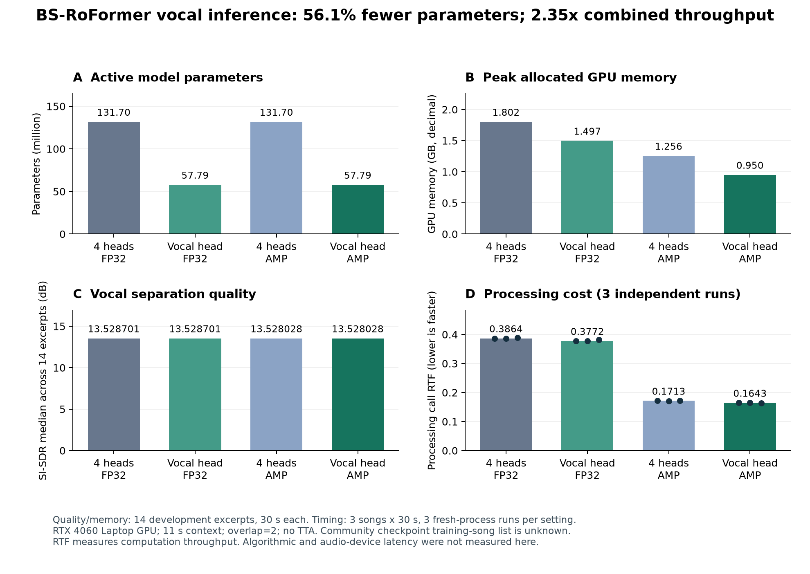

# VocalStream：音乐人声分离的质量、计算与延迟

[English](README.md) · [实验结果](docs/RESULTS.zh-CN.md) · [复现步骤](docs/REPRODUCING.md) · [方法与边界](docs/METHODOLOGY.md)

这个项目使用 Open-Unmix 基线和预训练 BS-RoFormer，研究一个具体问题：**只需要人声时，能减少多少计算与显存；限制未来音频和输出等待后，质量与计算预算会发生什么变化？**

## 已经做出了什么

- **人声专用推理**：完整严格加载原四分支权重后，只计算原来的人声分支；保留共享网络和人声权重。
- **质量与资源实验**：14 首相同的开发歌曲片段，四组精度/分支设置，以及每组三次独立计时。
- **受控串音与原声保留**：用对齐分轨生成不同程度的伴奏串音，检查去除干扰时是否损伤人声。
- **有限未来信息实验**：逐包输入，明确区分过去缓存、输出块和未来信息，记录每块耗时、预算超时与虚拟排队。
- **可追溯记录**：配置、命令、环境、权重/代码/音频哈希、逐曲评分和输出目录。

## 主要结果

在 RTX 4060 Laptop GPU 上：

| 指标 | 四分支 FP32 | 仅人声＋混合精度 |
| --- | ---: | ---: |
| 运行中参数量 | 1.317 亿 | 5780 万 |
| 峰值已分配显存 | 1.8019 GB | 0.9503 GB |
| 三次调用 RTF 中位数 | 0.386387 | 0.164287 |
| 人声 SI-SDR 中位数 | 13.528701 dB | 13.528028 dB |

组合后的吞吐约为原来的 **2.35 倍**。只选择人声分支这一项改动，在 FP32 与 AMP 各自的 14/14 个片段上均保持同精度输出逐采样相同；单独的速度收益约为 2%–4%，大部分组合加速来自混合精度。



流式研究也保留了负结果：当前重复计算离线窗口的实现，每块约需 **208 毫秒**，超过 20/80 毫秒输出预算。更多未来信息改善了当前短片段的质量，但当前实现尚未达到超低延迟。

这些是固定开发片段实验。权重的完整训练曲目名单未知，分数不能当作独立泛化或论文官方测试成绩。RTF 是计算吞吐，不能当作声卡端到端延迟。

## 安装与第一次运行

使用 Python 3.12，在仓库根目录运行。以下为 NVIDIA GPU 环境：

```shell
git clone https://github.com/junxilucian-rgb/vocalstream.git
cd vocalstream
conda create -n vocalstream python=3.12 pip -y
conda activate vocalstream
python -m pip install torch==2.11.0 torchaudio==2.11.0 --index-url https://download.pytorch.org/whl/cu128
python -m pip install -e .
python download_bs_roformer_assets.py
```

模型权重约 527 MB，下载器会核对固定 SHA256；请遵守发布者的模型使用条件。

准备一个 **44.1 kHz、双声道 WAV 或 FLAC**，替换下面的文件路径：

```shell
python evaluate_project.py --input path/to/music.flac --system bsroformer --bs-heads vocals --precision amp --overlap 2 --device cuda --save-audio --out results/demo_01
```

输出位于 `results/demo_01`。每次用新的输出目录。没有对齐的参考人声时只作试听，不会生成客观质量分数。

CPU 用户安装匹配的 CPU PyTorch，再使用 `--device cpu --precision fp32`。上面的速度结果来自记录中的 GPU 环境。

## 复现数据集实验

从 [MUSDB 官方页面](https://sigsep.github.io/datasets/musdb.html)获取 MUSDB18-HQ，并按要求申请和使用。数据目录应有 `train`、`test`，每首歌含 mixture/vocals/drums/bass/other 五个 WAV。

```shell
python run_head_optimization.py --root path/to/musdb18-hq --out results/head_study_01
python build_head_optimization_report.py --run results/head_study_01
python run_streaming_study.py --root path/to/musdb18-hq --out results/stream_study_01
python build_streaming_study_report.py --run results/stream_study_01
```

两组实验顺序执行，避免同时占用 GPU 污染计时。还可以通过 `MUSDB_ROOT` 配置数据目录。完整步骤见 [复现指南](docs/REPRODUCING.md)。

## 当前范围

这是 Codex 辅助实现与运行的研究工程项目，贡献包括任务适配、实验设计、推理优化和结果分析。项目没有提出新的分离网络。

已完成的片段实验不能替代整曲验证、冻结后的完整测试、真实麦克风/房间录音、声学反馈闭环和实际音频设备延迟测量。流式实现仍有窗口重算与无输出交叉淡化等限制。

仓库公开代码、脱敏统计和图表；音频、分轨、权重、私人路径和内部通信保留在仓库之外。公开副本做了路径与安装可移植性调整，尚未重新运行完整神经网络实验；报告保留原始研究代码哈希，新运行会生成新的记录。

项目代码使用 [MIT 许可](LICENSE)，第三方归属见 [THIRD_PARTY_NOTICES.md](THIRD_PARTY_NOTICES.md)。音频数据与模型权重各自适用原发布者的条款。
