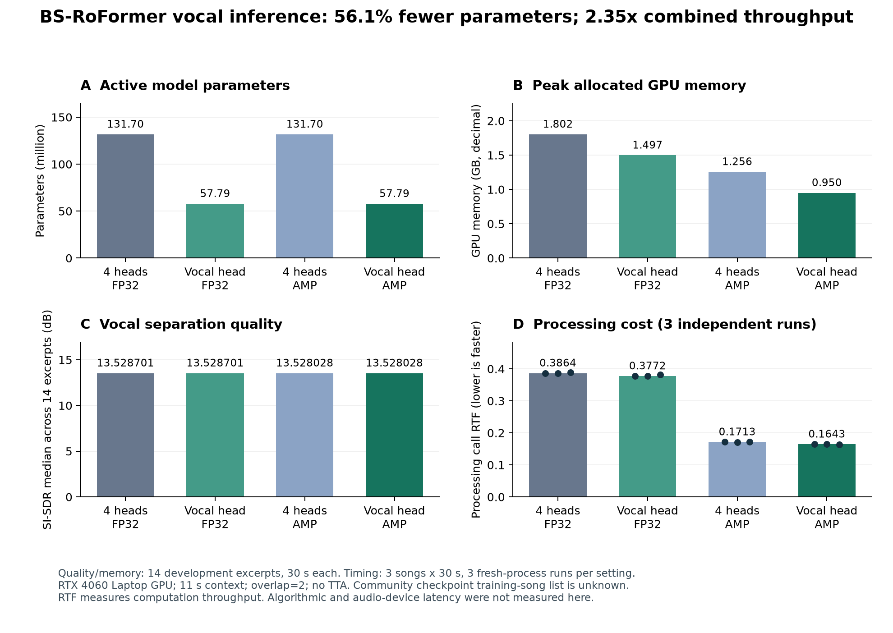
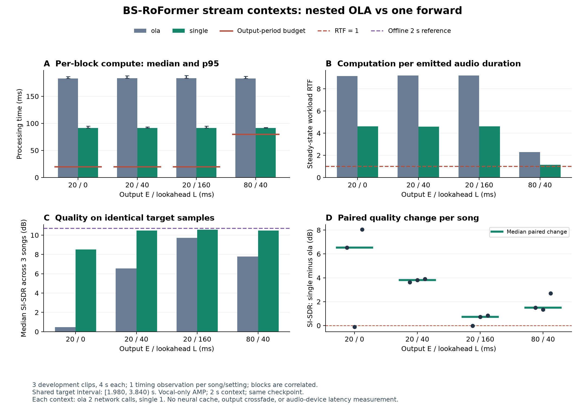

# Experimental results

[中文](RESULTS.zh-CN.md) · [Machine-readable evidence](../reports/index.json)

This project studies pretrained vocal extraction, inference cost and the limits of a simple file-streaming scheduler. **It does not demonstrate ultra-low-latency operation or a new state-of-the-art separation model.** All measurements below were completed on development excerpts; no training or formal test-set inference was performed.

## Setup and metric definitions

- MUSDB18-HQ, stereo 44.1 kHz. Offline quality: all 14 songs in the official development/validation list, the fixed 60–90 s excerpt of each song (420 s total per setting).
- BS-RoFormer community checkpoint from [ZFTurbo release v1.0.12](https://github.com/ZFTurbo/Music-Source-Separation-Training/releases/tag/v1.0.12), not the original paper checkpoint. Full training-song membership is undisclosed, so independence from pretraining cannot be established.
- Pinned publisher architecture commit: `aef04b2e52fb3beaf25e333199f5a7236e628e7b`. Checkpoint SHA-256: `3e9daecd70aaed5b5a0d1f861cc4d77eaa45afb3fc6301b1cf32c1be0f5868fb`. Configuration SHA-256: `d8afb980318d0c08b9c2e24a7adc00d4f3150320c127a7e4de861800d1321939`.
- NVIDIA GeForce RTX 4060 Laptop GPU, Windows 11, Python 3.12.10, PyTorch/Torchaudio `2.11.0+cu128`, NumPy `2.5.3`, SoundFile `0.14.0`, one PyTorch CPU thread. Full environment metadata is retained in the JSON reports.
- SI-SDR subtracts each channel's mean, then fits one shared scale after flattening stereo channels. SI-SDRi is output SI-SDR minus the matched input SI-SDR. Summaries are medians of song-level scores. This is not museval/BSS Eval SDR.
- Call RTF = separation-call seconds / audio seconds. Calls include preparation, transfers and overlap-add to a returned CPU waveform; loading, warm-up, file I/O, metric computation and audio-device buffering are excluded. RTF < 1 describes throughput, not algorithmic or device latency.
- VRAM figures are PyTorch peak **allocated** memory in decimal GB (`10^9` bytes), measured per quality excerpt. Reserved allocator memory is separately retained in JSON; neither is a system-wide GPU-memory measurement.

## 1. Retaining only the vocal output head

Four-head and vocal-only variants use identical shared-backbone and vocal-head weights. The full checkpoint is loaded strictly before the three unused heads are discarded from the in-memory model. The checkpoint file is not rewritten or reduced. Context is 11 s, overlap = 2, no test-time augmentation.

| Setting | Median SI-SDR (dB) | In-memory parameters | Peak allocated GB | Median repeated call RTF |
|---|---:|---:|---:|---:|
| Four heads, FP32 | 13.528701 | 131,704,164 | 1.8019 | 0.386387 |
| Vocal only, FP32 | 13.528701 | 57,790,284 | 1.4969 | 0.377215 |
| Four heads, AMP | 13.528028 | 131,704,164 | 1.2556 | 0.171275 |
| Vocal only, AMP | 13.528028 | 57,790,284 | 0.9503 | 0.164287 |

The three unused heads contain 73,913,880 parameters (56.12% of the full model). Head selection alone reduced median call time by **2.37% in FP32** and **4.08% in AMP**. Combined vocal-only + AMP throughput was **2.3519×** the four-head FP32 baseline (57.48% lower call time). Most of that speed benefit came from AMP, not head selection.

### Numerical comparison

Predeclared same-precision tolerances were unscaled waveform NRMSE ≤ `1e-5` **and** per-song absolute SI-SDR change ≤ `0.001 dB`. No gain fitting, time-shift search, peak clipping or normalization was used for the waveform comparison.

| Comparison | Samplewise-identical excerpts | Maximum sample error | Maximum NRMSE | Maximum absolute SI-SDR change |
|---|---:|---:|---:|---:|
| Vocal FP32 vs four-head FP32 | 14/14 | 0 | 0 | 0 dB |
| Vocal AMP vs four-head AMP | 14/14 | 0 | 0 | 0 dB |

This describes the stored FLOAT-WAV outputs in this workload, not a mathematical, perceptual or cross-device guarantee. AMP versus FP32 was not identical: the median paired SI-SDR change was `−0.000176046822 dB`, the maximum absolute per-song change was `0.00357066087 dB`, and maximum waveform NRMSE was `0.00369545321`. The same-precision pass thresholds were not retrospectively applied to this cross-precision comparison.

### Independent timing runs

Each timing run used a fresh process with loading and warm-up outside the timer. Three fixed development songs supplied 90 s of audio per setting, repeated three times with setting order varied by round. Repeated timing does not increase the number of independent songs.

| Setting | Repeat 1 RTF | Repeat 2 RTF | Repeat 3 RTF |
|---|---:|---:|---:|
| Four heads, FP32 | 0.386387 | 0.386261 | 0.388678 |
| Vocal only, FP32 | 0.377215 | 0.377016 | 0.381950 |
| Four heads, AMP | 0.171656 | 0.171250 | 0.171275 |
| Vocal only, AMP | 0.164287 | 0.164428 | 0.164196 |

Evidence: [analysis, per-song errors, hashes and 16-job manifest](../reports/head_optimization.json). Sanitized per-job reports are under [reports/head_optimization/jobs](../reports/head_optimization/jobs/).

## 2. Limited-look-ahead file-streaming study

Three development songs were sampled at 60–64 s. The vocal-only AMP model had 2 s context, overlap = 2. A rolling file-input scheduler repeatedly recomputed a complete context window and emitted a small slice; there was no cached neural state, microphone, speaker or actual real-time wait. Twelve streaming jobs and one three-song offline reference job were completed.

`E` is the emitted block duration and `L` is future context beyond its end. Nominal input availability is `E + L` from the first sample boundary, or `L` from the final boundary. It excludes processing and queueing. `L = 0` is not samplewise zero latency: earlier samples within an output block can use later samples in that block.

All quality comparisons below use exactly the same clip-relative interval **[1.980, 3.840) s** (82,026 samples, 1.860 s) in each song. This excludes every setting's startup padding and EOF region. The offline reference also uses 2 s context; it is not the 11 s quality setting above.

| Setting | E / L (ms) | Common-interval median SI-SDR (dB) | Median paired change vs offline (dB) | Steady-block compute p50 / p95 (ms) | Compute-over-period rate |
|---|---:|---:|---:|---:|---:|
| Offline 2 s reference | — | 10.709 | 0.000 | — | — |
| emit20_look0 | 20 / 0 | 0.474 | −9.016 | 208.25 / 212.05 | 100% |
| emit20_look40 | 20 / 40 | 6.565 | −4.144 | 207.99 / 210.83 | 100% |
| emit20_look160 | 20 / 160 | 9.717 | −0.442 | 208.05 / 211.80 | 100% |
| emit80_look40 | 80 / 40 | 7.781 | −1.889 | 207.90 / 212.13 | 100% |

More future context improved these short excerpts, but **all tested streaming configurations exceeded their output period**. Steady workload RTFs were approximately 10.40–10.43 for 20 ms emission and 2.60 for 80 ms emission. The simple recomputation strategy was not real-time capable at those periods on this hardware.

Timing quantiles pool 303 steady blocks per 20 ms setting and 75 per 80 ms setting across three songs. Blocks are correlated; there was only one timing run per song/setting. The queue simulation uses `finish = max(input_arrival, previous_finish) + measured_compute`, with deadline `input_arrival + E`; every steady block missed that simulated deadline. Queue values are **virtual single-worker estimates, not measured device latency**. No end-to-end audio latency was measured.

Evidence: [quality, timing, provenance and 13-job manifest](../reports/streaming_study.json). Per-block records are preserved in [sanitized job reports](../reports/streaming_study/jobs/).

## 3. Earlier baseline and controlled-bleed experiment

These separate experiments used the same 14 fixed 30 s excerpts. Open-Unmix was `umxhq`, `niter=1`; BS-RoFormer used the same community weights. Their quality-call RTF values are single expanded-quality runs, not the independent timing medians in section 1.

| Model | Median SI-SDR (dB) | Quality-call RTF |
|---|---:|---:|
| Open-Unmix HQ | 6.619 | 0.0121 |
| BS-RoFormer 11 s FP32 | 13.529 | 0.3882 |
| BS-RoFormer 11 s AMP | 13.528 | 0.1749 |
| BS-RoFormer 2 s FP32 | 13.024 | 0.2466 |

For 2 s versus 11 s FP32, the median **paired** SI-SDR difference was about −0.498 dB, with all 14 excerpts lower. This is not evidence that a shorter context is causal.

Controlled bleed used `input = vocals + 10^(gain_db/20) × backing` at backing gains −30/−20/−10 dB. Gain is not a fixed vocal-to-interference SNR. The aligned original vocal stem is the target; it may already contain production effects and is not guaranteed to be a dry close-microphone recording.

| Backing gain | Open-Unmix median SI-SDRi / improved songs | BS AMP median SI-SDRi / improved songs |
|---|---:|---:|
| −30 dB | −6.216 dB / 3 of 14 | +7.526 dB / 14 of 14 |
| −20 dB | +1.843 dB / 10 of 14 | +10.742 dB / 14 of 14 |
| −10 dB | +7.620 dB / 13 of 14 | +13.951 dB / 14 of 14 |

The weak-bleed result shows why preservation matters: processing can damage an already fairly clean input. Original-vocal-only median unscaled NRMSE was approximately 0.09074 for Open-Unmix and 0.005871 for BS AMP; NRMSE is a waveform error ratio, not a perceived percentage of residual sound.

Evidence: [18-job refinement analysis and manifest](../reports/refinement.json); [overview figure](../assets/refinement_overview.png).

## 4. Removing nested overlap-add from stream windows

On 2026-10-22, a 25-job matched study reran both `ola` and `single` policies on the same three 60–64 s development excerpts. Both use vocal-only AMP, the same checkpoint, two-second context and the same four output/lookahead schedules. The comparison changes only how the supplied window is processed internally. `ola` makes two model calls and averages their outputs; `single` makes one call without this inner averaging. It retains the model's STFT/ISTFT and bidirectional attention.

| E / L (ms) | Block compute p50: ola → single (ms) | Steady total compute ratio ola ÷ single | Median paired SI-SDR change single − ola (dB) |
| --- | ---: | ---: | ---: |
| 20 / 0 | 182.91 → 91.60 | 1.991 | +6.528 |
| 20 / 40 | 183.45 → 91.39 | 2.007 | +3.813 |
| 20 / 160 | 183.42 → 91.65 | 1.997 | +0.731 |
| 80 / 40 | 183.11 → 91.32 | 2.007 | +1.502 |

Quality uses the identical clip-relative `[1.980, 3.840)` s interval across all eight streaming settings and the offline reference. Every paired median is positive, but two individual song/schedule pairs decreased slightly (approximately −0.105 dB and −0.029 dB). These are median paired changes, not differences between two score medians. There is one timing run per song/schedule/policy; pooled block quantiles do not provide independent timing repetitions.

The fresh OLA baseline was approximately 183 ms here; the earlier 208 ms timing is a separate observation. At 80/40 ms, workload RTF improved from 2.293 to 1.143. **All observed steady blocks still exceeded their compute period.** This change reduces computation and virtual backlog but does not establish real-time device operation. Both policies still recompute the Transformer for each emission; there is no neural cache or output crossfade. No automated software test suite or subjective listener study was run for this change.

Evidence: [25-job analysis and sanitized reports](../reports/window_comparison.json), [protocol and interpretation](WINDOW_INFERENCE.md).

## Evidence publication and limitations

The [export utility](../scripts/export_public_results.py) reads existing evidence, verifies each original job report's SHA-256 against its completed run record, and exports sanitized JSON. It never runs a model. All 72 per-job reports are included: the earlier 47 plus the new 25-job window comparison. Measurements, per-track errors, streaming block timings, runtime metadata and source/checkpoint/input/output hashes are retained. Absolute local paths become logical project-relative or `MUSDB18-HQ/` identifiers; unknown runtime/cache paths are omitted. Audio, model weights, console logs and correspondence are excluded. Historical audio/log path identifiers in JSON do not imply those files are publicly available.

`original_*_sha256` values identify the original private evidence, whose bytes differ from the sanitized exports. `reports/index.json` and each job manifest also record SHA-256 values for the actual published JSON files. Source hashes describe the historical experiment versions; publication edits can make current source hashes differ. Reproducing a run creates new timing and potentially new numeric outputs; it does not overwrite historical evidence.

These are fixed development excerpts with unknown checkpoint pretraining overlap, not a held-out full-song benchmark. There was no formal test evaluation, training, real microphone data, acoustic-feedback closed loop, subjective listener study or sound-card latency measurement. GPU clocks, temperature, software and concurrent workloads affect performance. A useful next step is cached/stateful low-latency inference or an explicitly causal model, followed by full-song and device-level validation.
