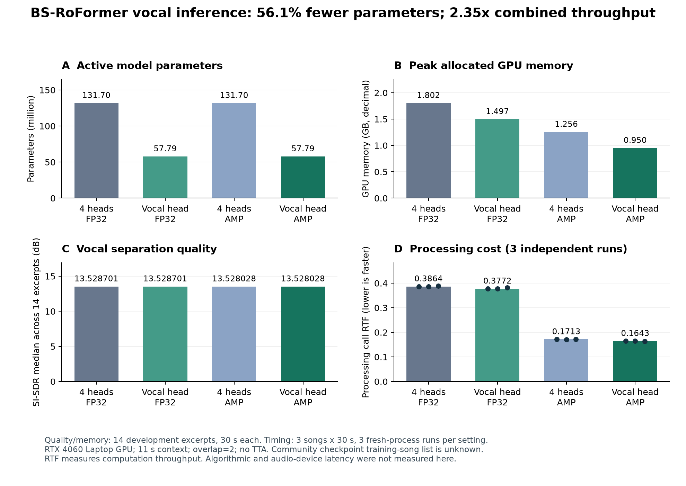

# 实验结果

[English](RESULTS.md) · [机器可读证据索引](../reports/index.json)

本项目研究预训练人声分离、推理开销，以及简单文件流式调度的限制。**当前结果没有证明超低延迟运行，也不代表提出了新的最优分离模型。** 所有实验使用开发片段；没有训练或正式测试集推理。

## 实验条件与指标

- MUSDB18-HQ，立体声 44.1 kHz。离线质量实验使用官方开发/验证名单的全部 14 首歌，每首固定 60–90 秒，共 420 秒音频。
- BS-RoFormer 使用 [ZFTurbo v1.0.12 社区权重](https://github.com/ZFTurbo/Music-Source-Separation-Training/releases/tag/v1.0.12)，并非原论文的同一 checkpoint。完整训练歌曲名单未披露，因此无法证明这些开发歌曲独立于预训练数据。
- 发布者架构固定在提交 `aef04b2e52fb3beaf25e333199f5a7236e628e7b`。权重 SHA-256：`3e9daecd70aaed5b5a0d1f861cc4d77eaa45afb3fc6301b1cf32c1be0f5868fb`；配置 SHA-256：`d8afb980318d0c08b9c2e24a7adc00d4f3150320c127a7e4de861800d1321939`。
- RTX 4060 Laptop GPU、Windows 11、Python 3.12.10、PyTorch/Torchaudio `2.11.0+cu128`、NumPy `2.5.3`、SoundFile `0.14.0`，PyTorch CPU 线程数为 1。完整环境信息保存在 JSON 中。
- SI-SDR 先按声道减均值，再展开立体声、拟合一个共享比例。SI-SDRi 是输出分数减去同一输入分数；汇总取逐曲分数中位数。这不是 museval/BSS Eval SDR。
- 调用 RTF = 分离调用耗时 / 音频时长。包含准备、数据传输、重叠拼接并返回 CPU 波形；排除加载、预热、文件读写、评分和声卡缓冲。RTF < 1 表示吞吐能力，不等于算法或设备延迟。
- 显存使用 PyTorch 逐片段峰值 allocated memory，GB = `10^9` 字节。reserved 缓存另存 JSON；两者都不是整个 GPU 的系统级显存占用。

## 1. 仅保留人声输出分支

共享主干与人声分支权重保持一致。先严格加载完整权重，再从内存模型移除三个不用的输出分支；没有改写或缩小 checkpoint 文件。输入上下文 11 秒、overlap = 2、无测试时增强。

| 设置 | SI-SDR 中位数 dB | 内存模型参数量 | 峰值 allocated GB | 三次计时 RTF 中位数 |
|---|---:|---:|---:|---:|
| 四分支 FP32 | 13.528701 | 131,704,164 | 1.8019 | 0.386387 |
| 仅人声 FP32 | 13.528701 | 57,790,284 | 1.4969 | 0.377215 |
| 四分支 AMP | 13.528028 | 131,704,164 | 1.2556 | 0.171275 |
| 仅人声 AMP | 13.528028 | 57,790,284 | 0.9503 | 0.164287 |

三个不用的分支共含 73,913,880 个参数，占完整模型的 56.12%。**仅分支选择**使 FP32 调用耗时减少 2.37%，AMP 减少 4.08%。仅人声＋AMP 相对于四分支 FP32 的吞吐速度为 **2.3519 倍**，调用耗时减少 57.48%。主要速度收益来自 AMP，不能全部归因于分支选择。

同精度比较的预先声明阈值为：不拟合增益的波形 NRMSE ≤ `1e-5`，并且逐曲 SI-SDR 绝对变化 ≤ `0.001 dB`。不做归一化、时移搜索、峰值裁剪或增益拟合。

| 同精度比较 | 保存波形逐采样相同的片段 | 最大样本误差 | 最大 NRMSE | 最大 SI-SDR 绝对变化 |
|---|---:|---:|---:|---:|
| 仅人声 FP32 与四分支 FP32 | 14/14 | 0 | 0 | 0 dB |
| 仅人声 AMP 与四分支 AMP | 14/14 | 0 | 0 | 0 dB |

这只描述当前工作负载下保存的 FLOAT WAV，不保证数学等价、主观音质等价或跨设备一致。AMP 与 FP32 **并非逐采样相同**：逐曲 SI-SDR 差值中位数为 `−0.000176046822 dB`，最大绝对变化 `0.00357066087 dB`，最大波形 NRMSE `0.00369545321`。同精度阈值没有事后套用到跨精度比较。

每组额外计时三次，每次使用全新进程、重新加载和预热，计时排除加载预热；三首固定开发歌曲共 90 秒，各轮改变设置顺序。重复计时不会增加独立歌曲数量。

| 设置 | 第一次 RTF | 第二次 RTF | 第三次 RTF |
|---|---:|---:|---:|
| 四分支 FP32 | 0.386387 | 0.386261 | 0.388678 |
| 仅人声 FP32 | 0.377215 | 0.377016 | 0.381950 |
| 四分支 AMP | 0.171656 | 0.171250 | 0.171275 |
| 仅人声 AMP | 0.164287 | 0.164428 | 0.164196 |

证据：[逐曲误差、汇总、哈希与 16 项任务清单](../reports/head_optimization.json)；[逐任务报告](../reports/head_optimization/jobs/)。

## 2. 有限未来信息的文件流实验

三首开发歌曲各截取 60–64 秒，仅人声 AMP、2 秒上下文、overlap = 2。滚动接收文件输入，每次重新计算整个上下文窗口，再截取一小块人声；没有神经状态缓存、麦克风、扬声器或真实按音频时钟等待。完成 12 项流式任务及 1 项包含三首歌的离线参照任务。

`E` 表示输出块长度，`L` 表示块末端之后的未来信息。从块首样本边界计算的名义输入等待为 `E + L`，从块末边界计算为 `L`；均不含计算和排队。`L = 0` 不等于逐样本零延迟，因为同块早期样本仍可使用该块后续输入。

各设置在完全相同的片段内区间 **[1.980, 3.840) 秒**评分，共 82,026 个样本、1.860 秒；排除所有设置的启动左填充和 EOF。离线参照同样使用 2 秒上下文，不是前述 11 秒质量设置。

| 设置 | E / L 毫秒 | 公共区间 SI-SDR 中位数 dB | 相对离线的逐曲差值中位数 dB | 稳态块计算 p50 / p95 毫秒 | 超出块周期 |
|---|---:|---:|---:|---:|---:|
| 离线 2 秒参照 | — | 10.709 | 0.000 | — | — |
| emit20_look0 | 20 / 0 | 0.474 | −9.016 | 208.25 / 212.05 | 100% |
| emit20_look40 | 20 / 40 | 6.565 | −4.144 | 207.99 / 210.83 | 100% |
| emit20_look160 | 20 / 160 | 9.717 | −0.442 | 208.05 / 211.80 | 100% |
| emit80_look40 | 80 / 40 | 7.781 | −1.889 | 207.90 / 212.13 | 100% |

更多未来信息改善了这些短片段的质量，但**全部流式配置均未满足对应输出周期的计算预算**。20 毫秒输出的稳态工作量 RTF 约 10.40–10.43，80 毫秒约 2.60。当前整窗重算方案无法在此硬件上按这些周期实时交付。

计时分位数合并三首歌的稳态块：每个 20 毫秒设置 303 块，80 毫秒设置 75 块。块之间高度相关；每首歌、每个设置仅运行一次。虚拟单工作线程使用 `finish = max(输入到达时间, 上一块完成时间) + 实测计算耗时`，截止时间为 `输入到达时间 + E`，稳态虚拟截止时间错过率均为 100%。**虚拟排队不是设备实测延迟**；没有测量声卡端到端延迟。

证据：[质量、计时、来源与 13 项任务清单](../reports/streaming_study.json)；[含逐块记录的任务报告](../reports/streaming_study/jobs/)。

## 3. 之前的基线与受控串音实验

同样使用 14 首歌固定 30 秒片段。Open-Unmix 为 `umxhq`、`niter=1`；BS-RoFormer 使用相同社区权重。下表 RTF 来自各自一次扩展质量任务，不是第一节的独立计时中位数。

| 模型 | SI-SDR 中位数 dB | 质量任务调用 RTF |
|---|---:|---:|
| Open-Unmix HQ | 6.619 | 0.0121 |
| BS-RoFormer 11 秒 FP32 | 13.529 | 0.3882 |
| BS-RoFormer 11 秒 AMP | 13.528 | 0.1749 |
| BS-RoFormer 2 秒 FP32 | 13.024 | 0.2466 |

2 秒相对于 11 秒 FP32 的逐曲 SI-SDR 差值中位数约为 −0.498 dB，14 首均降低；缩短上下文没有让模型自动变成因果网络。

受控串音输入为 `人声 + 10^(gain_db/20) × 伴奏`，伴奏增益取 −30/−20/−10 dB。增益不等于固定的人声干扰比。目标是原始人声 stem，可能已经含制作效果，不保证是物理干声或近讲麦克风信号。

| 伴奏增益 | Open-Unmix SI-SDRi 中位数 / 改善歌曲 | BS AMP SI-SDRi 中位数 / 改善歌曲 |
|---|---:|---:|
| −30 dB | −6.216 dB / 3 首，共 14 首 | +7.526 dB / 14 首，共 14 首 |
| −20 dB | +1.843 dB / 10 首，共 14 首 | +10.742 dB / 14 首，共 14 首 |
| −10 dB | +7.620 dB / 13 首，共 14 首 | +13.951 dB / 14 首，共 14 首 |

弱串音说明需要关注保真：原本较干净的输入也可能被处理损伤。仅原始人声输入时，Open-Unmix 的不拟合增益 NRMSE 中位数约 0.09074，BS AMP 约 0.005871；NRMSE 是波形误差比，不是听感残留百分比。

证据：[18 项完善实验的分析与清单](../reports/refinement.json)；[结果图](../assets/refinement_overview.png)。

## 公开证据与限制

[导出工具](../scripts/export_public_results.py)只读取现有实验，逐项核对原始报告与已完成运行记录的 SHA-256，再导出脱敏 JSON，不运行模型。共公开 47 份逐任务报告，保留测量值、逐曲误差、流式逐块耗时、环境信息和代码/权重/输入/输出哈希。绝对路径转换为逻辑项目相对标识或 `MUSDB18-HQ/` 标识，其他运行时与缓存路径省略。不包含音频、权重、控制台日志或通信内容；JSON 中历史音频与日志标识不表示这些文件已公开。

`original_*_sha256` 指向私有原始证据，脱敏后文件字节不同；`reports/index.json` 和任务清单另记实际公开 JSON 的哈希。源码哈希描述历史实验版本，发布时整理过的源码可能有不同哈希。复现会产生新计时及可能不同的数值输出，不覆盖历史证据。

这些是预训练重叠情况未知的固定开发片段，不是独立留出的整曲正式测试。尚无训练、真实麦克风数据、声学反馈闭环、主观听音研究或声卡延迟测量。速度受频率、温度、软件和其他进程影响。后续可研究缓存/状态复用或明确的因果模型，再补充整曲和设备级验证。
