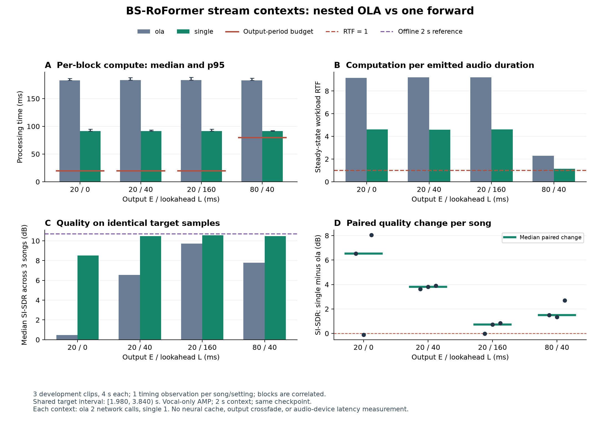

# Removing nested overlap-add from file-stream inference

[中文概述](#中文概述) · [Streaming protocol](../STREAMING_EVALUATION.md) · [Recorded results](RESULTS.md)

## Status

Implemented and evaluated on 2026-10-22 in a completed **25-job matched GPU
development study**. No automated software test suite was run. The earlier
47 public job reports remain unchanged; 25 additional sanitized reports are
available in [window_comparison.json](../reports/window_comparison.json).

## Measured comparison

RTX 4060 Laptop GPU, vocal-only AMP, two-second context, same checkpoint and
runtime for both policies. Three songs, four-second clips starting at 60 s;
quality is scored on the identical `[1.980, 3.840)` s target interval in each
clip. There is one timing observation per song/schedule/policy.

| E / L (ms) | Block compute p50: ola → single (ms) | Steady total compute ratio ola ÷ single | Median paired SI-SDR change single − ola (dB) |
| --- | ---: | ---: | ---: |
| 20 / 0 | 182.91 → 91.60 | 1.991 | +6.528 |
| 20 / 40 | 183.45 → 91.39 | 2.007 | +3.813 |
| 20 / 160 | 183.42 → 91.65 | 1.997 | +0.731 |
| 80 / 40 | 183.11 → 91.32 | 2.007 | +1.502 |

All four schedule-level paired quality medians improved on these clips, but
individual songs did not uniformly improve: two song/schedule pairs changed
by approximately −0.105 dB and −0.029 dB. At 80/40 ms, workload RTF fell from
2.293 to 1.143. **All observed steady blocks still exceeded their 20/80 ms
compute budgets.** Fewer calls reduced computation and virtual backlog; they
did not establish real-time or ultra-low-latency device operation.



The new OLA baseline is approximately 183 ms here, rather than the earlier
208 ms observation. This study reran both policies; performance ratios use
that fresh matched baseline. They are not computed against historical timing.
The paired SI-SDR median is the median of song-wise changes, which can differ
from subtracting the two median scores. Short clips, unknown pretraining
overlap, correlated blocks and the single timing trial limit the conclusion.

## Why this change

The recorded rolling-window implementation took approximately 208 ms to emit
one 20/80 ms block on the recorded RTX 4060 Laptop setup. Each emission calls
an offline adapter on its entire two-second context. With overlap=2, that
adapter invokes the network twice: one full context and one half-context
right-padded to the model's input length. The predictions are weighted and
averaged before the outer stream adapter extracts the emitted interval.

The new `single` policy directly invokes the same pinned network once on the
received two-second window and extracts the same output interval afterward.
It removes the inner chunk loop, its tail padding and weighted averaging.
Both policies still recompute their Transformer features for every emission.

For a two-second outer context, the old adapter's second call contains the
last one second of that context plus one second of synthetic right zeros.
Its weighted prediction can affect the output near the context's right edge,
where the stream adapter extracts its block. Removing this prediction changes
both the amount of computation and the effective inference context used in
the final average. Consequently this is a quality/cost ablation, not an
algebraically equivalent elimination of unused work. The model's own centered
STFT boundary handling remains in both policies.

| Property | `ola` (default) | `single` (opt-in) |
| --- | --- | --- |
| Checkpoint and pretrained vocal head | Same | Same |
| Outer input context and output schedule | Fixed by stream arguments | Same |
| Network forwards per exact two-second context, no TTA | 2 | 1 |
| Inner overlap-add | Yes | No |
| Neural/STFT state reused between emissions | No | No |
| Crossfade between emitted blocks | No | No |
| Identical vocal waveform guaranteed | No cross-policy claim | No cross-policy claim |

The call-count difference follows from the implementation; runtime and quality
must be measured. The model's own STFT/ISTFT, including its centered boundary
handling, remains inside each forward. The network still has bidirectional
attention. Its input is bounded by the outer window; it cannot read real input
outside that window.

For output `[s, s+E)`, both policies use only the supplied `[s-P, s+E+L)` input.
Removing inner overlap-add does not change the nominal input wait `E+L` or
make the architecture causal. Changes in computation can change the simulated
queue and output-ready time. Those virtual times are not soundcard latency.

## Run a single comparison pair

Install the project dependencies and obtain the pinned model assets using the
README instructions first. Run from the repository root with the same Python
environment. The following PowerShell examples use an existing MUSDB18-HQ
dataset, a four-second development excerpt and separate NEW output folders.
Run them sequentially:

```powershell
python offline_stream_demo.py --input "D:\musdb\train\Actions - One Minute Smile\mixture.wav" --reference "D:\musdb\train\Actions - One Minute Smile\vocals.wav" --output results/window_pair_ola_01 --start 60 --duration 4 --context-seconds 2 --emit-seconds 0.08 --lookahead-seconds 0.04 --heads vocals --precision amp --device cuda --window-inference ola
python offline_stream_demo.py --input "D:\musdb\train\Actions - One Minute Smile\mixture.wav" --reference "D:\musdb\train\Actions - One Minute Smile\vocals.wav" --output results/window_pair_single_01 --start 60 --duration 4 --context-seconds 2 --emit-seconds 0.08 --lookahead-seconds 0.04 --heads vocals --precision amp --device cuda --window-inference single
```

For CPU use, change BOTH commands to `--device cpu --precision fp32`; CPU
timing cannot be compared directly to the historical GPU timing. Single-window
contexts must align to the fixed 441-sample STFT hop (10 ms at 44.1 kHz). The
worker rejects misaligned contexts before loading the model. No resampling,
gain normalization, output clipping or time-shift fitting is introduced.

## Run the matched development study

```powershell
python run_streaming_study.py --root "D:\musdb" --window-inference compare --out results/window_compare_01
python build_streaming_study_report.py --run results/window_compare_01
```

This declares **25 jobs**: three fixed development songs × four output/lookahead
schedules × two inference policies, plus one three-song offline reference job.
The clips start at 60 s and last four seconds. The schedules remain
`E/L = 20/0, 20/40, 20/160, 80/40 ms`; all use the same two-second context,
vocal-only head, AMP and checkpoint. This runner requires CUDA.

Settings rotate and reverse order across songs. Each worker is a fresh process
and loads and warms up its own model outside the measured stream computation.
There is **one timing observation per song/schedule/policy**, not three
independent timing repetitions of every setting. Highly overlapping blocks
are correlated observations, not additional independent songs or trials.

The runner freezes the new protocol, source hashes, input/reference hashes,
runtime and model assets. Repeating the exact command resumes compatible
unfinished work; completed reports are hash-checked. A code, runtime or
protocol change requires a NEW output folder. Historical experiment folders
cannot be resumed using the changed inference sources.

The report generator verifies completion, report/model/source hashes, wave
alignment, schedule identity and observed model call counts before scoring.
It compares all policies on one identical unpadded target interval. With the
default four-second clips, the schedules imply `[1.980, 3.840)` seconds,
relative to clip start; the actual interval is derived from emission records.
The reference vocal waveform is never a separator input.

Outputs include:

- `protocol.json` and `run.json`: frozen inputs, commands, worker status and GPU snapshots.
- Per-worker `report.json`: model calls per emission, compute time, peak allocated memory, dependencies, padding and virtual scheduling.
- `streaming_study_analysis.json`: per-song scores, common target interval, pooled steady-state timing and paired `single − ola` SI-SDR differences.
- `STREAMING_STUDY_RESULTS.md`: human-readable comparison. Its compute-time ratio is total matched steady-state work in `ola` divided by `single`; greater than one means `single` was faster in that run.

Optional plotting (requires the README's `[reports]` dependencies):

```powershell
python analysis_tools/plot_window_comparison.py --run results/window_compare_01
```

To append sanitized JSON evidence to `reports/` after analysis completes:

```powershell
python scripts/export_public_results.py --run results/window_compare_01 --study-name window_comparison
```

This export checks the completed run and analysis identities and preserves
existing evidence-index entries. Audio, weights, logs and absolute machine
paths remain excluded. Plotting and export do not run separation models.

`--window-inference ola` retains the original 13-job schedule and default
inference policy. `--window-inference single` declares a separate 13-job study.
Use `compare` for a direct policy comparison instead of comparing fresh timing
against a historical result from different runtime conditions.

## How to interpret the experiment

1. Confirm the recorded per-emission model call counts are 2 for `ola` and 1
   for `single`. The report builder rejects mismatches for this fixed study.
2. Inspect per-song SI-SDR on the shared target samples, the paired quality
   change and saved audio around output joins. Removing an averaging path may
   change quality or introduce audible boundary differences.
3. Inspect block p50/p95, workload RTF, compute-budget misses and virtual queue
   separately. Fewer calls alone do not demonstrate that 20/80 ms budgets pass.
4. Repeat a promising configuration in new experiment folders before making
   a stable speed claim. Longer excerpts, more development songs, listening
   and actual device measurements are further work.

For this iteration, no automatic model selection, quality-based tuning or
test-set evaluation is performed. A default change should follow evidence
about both quality and cost.

## 中文概述

这次优化针对流式处理内部的重复计算。旧方案每收到一个可输出的窗口，
还会在窗口里做两次网络推理和重叠平均；新方案直接对该窗口做一次推理。
两种方案使用相同权重、人声分支、输入窗口、输出周期和未来观察长度。

旧方案的第二次推理会用最后1秒真实输入加1秒补零，再参与加权平均。
移除它也会改变最终预测，因此必须同时比较质量，不能宣称波形等价。

**已完成25项 GPU 开发片段实验；未运行自动化软件测试套件。**
使用相同时间表重新运行旧方案后，每块计算中位数约从183毫秒降到91毫秒，
总计算时间约减半。四组设置的逐曲 SI-SDR 差值中位数均为正，但有两个
歌曲/设置组合略微下降。这里没有证明所有音频都改善，也没有主观听音结论。

80毫秒输出、40毫秒未来观察时，工作量 RTF 从2.293降到1.143，仍然大于1；
全部稳态块仍超出对应计算预算。减少窗口内部的重复计算后，窗口之间的整网
重算依旧存在。下一步可研究更短上下文的质量与预算，再考虑状态复用或因果模型。

从学习和面试角度，这个改动能说明：先从失败实验定位具体计算路径，
再提出可测量的改动，用固定条件的对照判断它是否有效。后续仍需检查音质，
重复计时，并研究真正的状态复用或因果网络。
